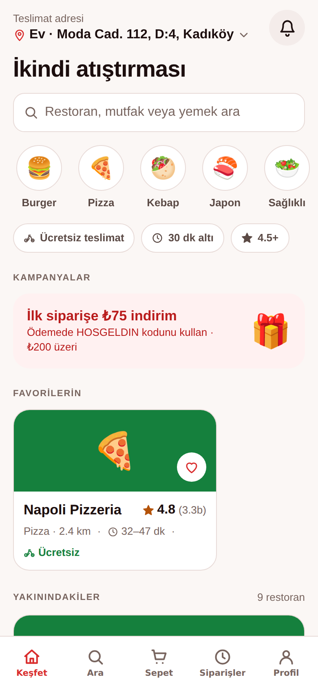

# Sofra — Yemek Sipariş Uygulaması ve Ödeme Akışı A/B Deneyi

Yerel bir yemek sipariş platformunun **sepet terk** sorununa odaklanan çalışan uygulama: keşif, menü, sepet ve iki farklı ödeme akışı (**A: klasik 4 adım**, **B: yeni tek sayfa**) aynı kod tabanında yaşar; uygulama içi **deney altyapısı** kullanıcıları deterministik olarak varyantlara atar, olayları kaydeder ve huni + istatistiksel anlamlılık hesaplar. **React Native + Expo**; iOS, Android ve web. Kurgusal marka, gerçek sipariş oluşmaz.



## UX kararları (ve kodda nerede)

| Sorun (araştırma bulgusu) | Çözüm | Kod |
|---|---|---|
| Teslimat ücreti ödemede sürpriz oluyordu | Ücret ve süre restoran kartında; menüde "₺X daha ekle, teslimat ücretsiz" ilerlemesi | `RestaurantCard`, `restoran/[id]`, `sepet` |
| Menülerde kaybolma | "Popüler" otomatik öne, yapışkan kategori çipleri bölüme kaydırır | `menuSections`, `restoran/[id]` |
| Adres girişinde hata | Haritadan dokunarak konum, açık adres otomatik; kayıtlı adresler tek dokunuş | `MapPreview`, `adres-ekle`, `odeme/tek` |
| 9 adımlı ödeme | Tek sayfa: adres, ödeme, bahşiş, not, özet ve toplam aynı ekranda; tek onay | `odeme/tek` |
| Kampanya görünürlüğü | Keşfet'te kampanya kartı, sepette promosyon alanı ve anında doğrulama | `index`, `sepet`, `totals()` |

Varyant A (`odeme/[adim]`) eski akışı kontrol grubu olarak taklit eder: il/ilçe/mahalle/posta kodu zorunlu form, 4 ekran, ücret yalnızca son adımda.

## Deney altyapısı (`src/lib/experiment.ts`)

- **Atama** — `assign(userId, "checkout-v2")`: FNV-1a özetiyle kararlı kova; 2.000 kullanıcıda ±%5 denge testle doğrulanır. Ürün ekibi paneli varyantı zorlayabilir.
- **Olaylar** — `restaurant_view`, `add_to_cart`, `cart_view`, `checkout_start`, `checkout_step`, `checkout_error`, `order_complete`; cihazda AsyncStorage ile birikir.
- **Huni** — sepete ekleyen oturum bazında sepet terk oranı, dönüşüm, ortalama ödeme adımı, form hatası.
- **Anlamlılık** — iki oran için z-testi (Abramowitz–Stegun normal CDF), kaldıraç (%), örneklem büyüklüğü hesabı (α 0,05, güç 0,8).
- **Sentetik veri** — panelin çalışmasını göstermek için xorshift tohumlu 1.200 oturum; arayüzde "sentetik" olarak ayrı sayılır, gerçek olaylarla karışmaz.

## Uygulama

Keşfet (adres, mutfak çipleri, ücretsiz/30 dk/4.5+ filtreleri, kampanya, favoriler, sıralı restoranlar) · Ara (menü içinde de arama, 4 sıralama) · Restoran (puan, süre, ücret, min. sipariş, akıllı kategoriler) · Ürün (zorunlu/çoklu seçenek grupları, not, adet; farklı restoran çakışma uyarısı) · Sepet (satır adetleri, "yanına iyi gider", promosyon kodları, ücretsiz teslimat ilerlemesi, küçük sipariş ücreti) · Ödeme A/B · Sipariş takibi (hızlandırılmış zaman çizgisi, harita) · Siparişler (tekrar sipariş) · Profil (adresler, tema, yazı boyutu, deney paneli).

Fiyat kuralları `src/lib/order.ts` içinde saf fonksiyonlardır: teslimat ücreti ve ücretsiz eşik, min. sipariş altı ₺15, servis ücreti, yüzde/sabit/ücretsiz-teslimat promosyonları (koşullu), bahşiş, yoğun saat ETA'sı.

## Tasarım sistemi

Bankam projesindeki belirteç mimarisi (`src/theme/tokens.ts`) sıcak/kırmızı paletle yeniden kullanıldı: açık/koyu tema, 11 çiftlik WCAG kontrast sözleşmesi testlerle doğrulanır, 3 kademeli yazı ölçeği, 44 pt dokunma hedefi, her etkileşimli öğede erişilebilirlik rolü/etiketi.

## Teknolojiler

React Native 0.86, Expo SDK 57, Expo Router, TypeScript (strict), react-native-svg, Zustand + AsyncStorage, Vitest, Playwright.

## Çalıştırma ve test

```bash
npm install
npx expo start                      # Expo Go
npm test                            # 37 birim testi: sepet, tutarlar, promosyon, ETA, keşif, deney atama/huni/z-testi, kontrast
npm run export:web && npm run serve 8081 &
npm run e2e                         # 42 kontrollü uçtan uca akış + 14 gerçek ekran görüntüsü (A ve B ödeme, deney paneli, koyu tema)
```

## Lisans

MIT — Uğur Can Elsun
